# Module 2 — Tracking, versioning, automation

Branch: `module-2-tracking-automation` · Tag after merge: `v0.2.0`

Status: Steps 1–7 done (this file).

## Step 1 — Tracking infrastructure

`docker/docker-compose.tracking.yml` runs three services: PostgreSQL (run metadata), RustFS, an S3-compatible object store (artifacts), and the MLflow 3.17.0 server.

```bash
docker compose -f docker/docker-compose.tracking.yml --env-file .env up -d --build
# MLflow UI: http://localhost:5000      object-store console: http://localhost:9001
```

`MLFLOW_TRACKING_URI` is read through `legal_rag.config` (default `http://localhost:5000`). The API compose file stays separate, so `docker compose up` for the API never starts the tracking stack.

## Step 2 — Experiment tracking

### What is tracked

Every run logs:

- **Params:** `embedding_model`, `variants`, `fusion`, `weights`, `chunk_strategy`, `chunk_size`, `overlap`, `corpus_sha256`, `eval_set_sha256`, `n_docs`, `n_questions`, `split`. Finalist runs add `faithfulness_judge`, `faithfulness_lang`, `faithfulness_n`, `faithfulness_gate`.
- **Metrics:** `hit_at_3`, `mrr` (overall and per language), `n_vectors`, `index_mb`; finalists also `faithfulness`, `faithfulness_below_gate`, `citation_valid_rate`, `judge_tokens_cold`.
- **Artifacts:** `misses.json` (questions the config failed), `requirements.txt` (the locked environment from `uv export`); finalists also `faithfulness.json`.
- **Tags:** `git_commit`, `data_version` (first 12 characters of the corpus SHA-256), `author`, `framework`, `family`. Step 4 adds the DVC hashes (below).

Because the corpus is chunked by article, one article is one chunk, so `chunk_size = "article"` and `overlap = 0` are logged as constants. What varies between runs is what is embedded for an article (Arabic, English, or both) and how the scores are fused.

### Three experiments, on purpose

| Experiment | Question it answers | Code |
|---|---|---|
| `legal-rag-retrieval` | Which representation retrieves best? Full sweep: 3 single-vector variants, a max fusion and an 11-step weighted fusion (nested runs), per embedding model | `experiments.py` |
| `legal-rag-finalists` | Of the best configs, which also gives faithful answers? Retrieval and faithfulness side by side | `finalists.py`, `faithfulness.py` |
| `legal-rag-holdout` | Does the choice survive questions it was never tuned on? Run once, never used to tune | `experiments.py --split holdout` |

They are separate because they answer different questions, and the hold-out must stay apart from the dev runs. The comparison view for this report is `legal-rag-finalists`, the only experiment where every run has both retrieval metrics and `faithfulness`. All runs share `git_commit = 11ec18a` and one `data_version`, so the comparison is on the same code and the same data.

### Autologging

Autologging is not applicable here: nothing is trained. The embedding models are used as they are, and the retrieval code is plain numpy. Everything above is logged manually, which is also why the metrics and the data hash are explicit.

### Comparison on the dev set (30 questions; faithfulness on 15 Arabic questions)

| Run | hit@3 | MRR | Arabic hit@3 | Faithfulness | Index (MB) |
|---|---|---|---|---|---|
| e5-base / ar and en vectors, max | 1.000 | 0.922 | 1.000 | 1.000 | 6.72 |
| e5-small / ar and en vectors, max | 1.000 | 0.817 | 1.000 | 0.983 | 3.36 |
| e5-base / alpha=0.5 | 0.967 | 0.861 | 0.933 | 0.962 | 6.72 |
| e5-base / ar+en | 0.933 | 0.834 | 0.933 | 0.942 | 3.36 |
| e5-base / ar | 0.733 | 0.642 | 1.000 | 1.000 | 3.36 |
| e5-small / ar | 0.700 | 0.557 | 1.000 | 0.983 | 1.68 |

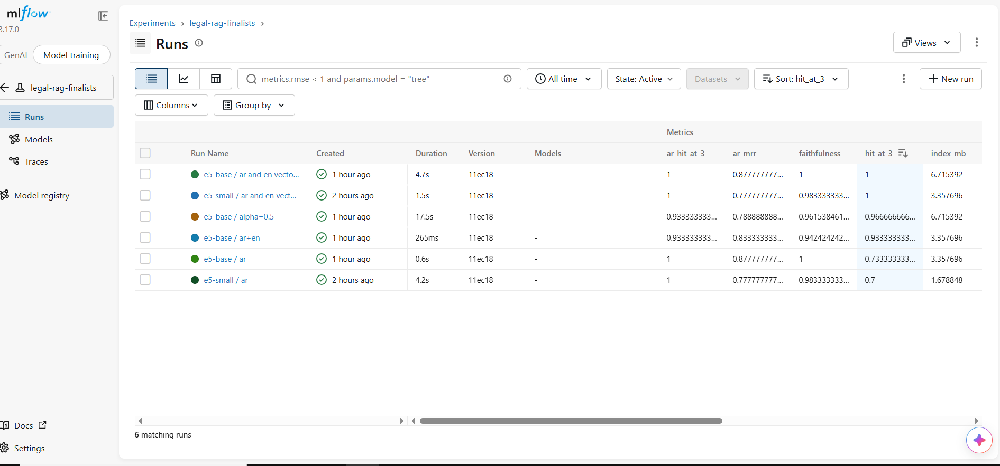
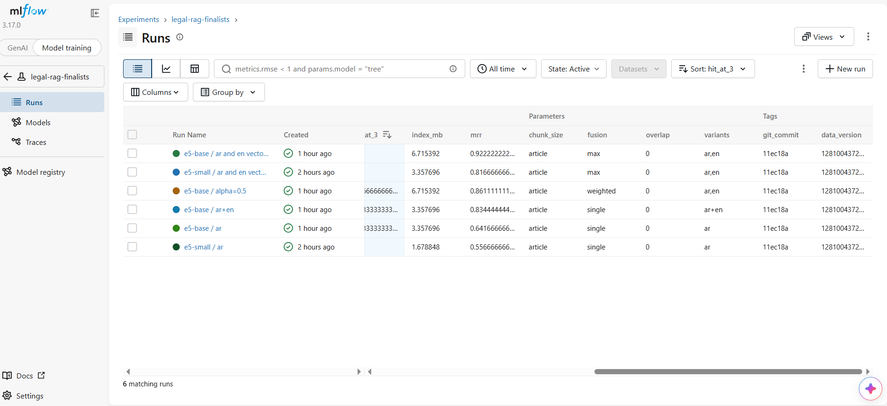

Taken before Step 3, so the Models column is still empty; the versions are registered afterwards.

How to read it:

- Mixing Arabic and English vectors (`max`) is what lifts hit@3 from 0.70–0.73 to 1.0 on the dev set.
- Faithfulness does not separate the configs: it ranges from 0.94 to 1.0 on 15 questions. It measures whether the answer is supported by the retrieved articles, not whether the right articles were retrieved (`e5-base / ar` has faithfulness 1.0 and hit@3 0.73). So hit@3 and MRR choose the config, and faithfulness stays as a gate against unsupported answers.
- `e5-small / max` reaches the same hit@3 as `e5-base / max` with half the index (3.36 MB against 6.72 MB), at a lower MRR (0.82 against 0.92).
- One dev question is 0.033 of hit@3, so differences of one question are signal, not proof. The config was also chosen on these same questions, which is why the hold-out exists.

## Hold-out check (20 questions, never used for tuning)

| Run | hit@3 | MRR |
|---|---|---|
| e5-base / ar and en vectors, max | 0.650 | 0.608 |
| e5-small / ar and en vectors, max | 0.600 | 0.524 |
| e5-small / ar | 0.500 | 0.429 |

- **The ranking holds:** mixing both languages beats Arabic alone (+0.10 hit@3) on unseen questions too.
- **The level does not:** `e5-small / max` scored 1.0 on dev and 0.6 on the hold-out. The honest expectation for this config on new questions is hit@3 around 0.6, not 1.0.
- **Base against small is inside the noise:** 13 against 12 questions out of 20. The base model fixed two questions (h10, h14) and broke one (h19). Its index is twice as large and serving it would need an ONNX export of e5-base.
- **The hold-out was looked at twice:** once for e5-small, then once for e5-base, so it is no longer a completely clean test. The decision rule (switch to base only for a clear gain, about +0.10 hit@3) was set before the base run, and the gain was +0.05.

### Why questions fail (`misses.json` of the hold-out runs)

Five of the 20 questions fail in all three runs (h07, h08, h12, h15, h18). The failures fall into three patterns:

1. **Near misses, right area, wrong article.** h07 (voidability under duress): gold is article 127, the retrievers return 125, 126, 138 or 140. h02 (a person's domicile): gold 40, retrieved 41 and 42. h19 (abuse of ownership): gold 807, retrieved 805 and 818. Neighbouring articles are probably relevant to a lawyer, so hit@3 against a single gold article is strict for these questions.
2. **Wrong legal topic.** h15 (employer liability for an employee's harm): gold is 174 (tort liability), every run returns articles in the 665–692 range, which are about employment contracts. The words "employer" and "worker" pull retrieval to the wrong part of the code. A re-ranker is the usual fix.
3. **English questions on an Arabic-only index.** 8 of the 10 failures of `e5-small / ar` are English questions; `max` reduces them to 6 (small) and 4 (base).

The misses were read to understand failure types only. The pipeline is not tuned to these 20 questions; any improvement is checked on new questions.

### Decision

Register **e5-small / ar and en vectors, max** as the retrieval config. It uses the same encoder the API already ships (ONNX e5-small), has half the index of the base model, and the base model's hold-out gain is not clear enough to pay for the extra export and size. One correction to the first version of this section: before Step 3 the API did *not* serve this config. It searched a Chroma index with one Arabic vector per article, which is the `e5-small / ar` config. Step 3 is what makes the service use the chosen one. If a clear gain appears on new questions, the registry makes switching a one-line alias change.

## Step 3 — Model registry

### What is registered

The registered model is `legal-rag-retriever`. A "model" here is the retriever: the config the finalist run logged (embedding model, text variants, fusion, weights), the passage vectors read from the experiment cache, and the list of articles those vectors are rows of, wrapped as an MLflow pyfunc model (`retriever_model.py`, logged as code so it loads without `legal_rag` installed). It is logged *into the finalist run itself*, so a version links to the metrics, params, `git_commit` and `data_version` that justified it. Registering refuses a run whose corpus hash no longer matches the corpus on disk.

| Version | Run | Config | Alias |
|---|---|---|---|
| 1 | `e5-small / ar and en vectors, max` | two vectors, `max` fusion | `production` (and `staging`) |
| 2 | `e5-small / ar` | one Arabic vector | none ("None") |

MLflow 3 deprecates registry stages, so the handbook's None → Staging → Production lifecycle is expressed with aliases: a version without alias is None, `staging` and `production` are the other two. Serving loads `models:/legal-rag-retriever@production`.

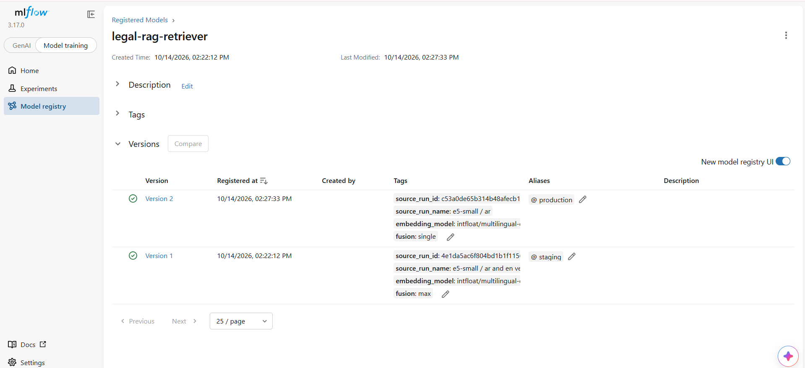
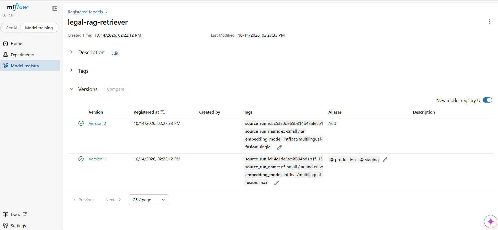

### The API loads the model from the registry

`legal_rag.registry_rag.RegistryRAG` has the same surface as the Chroma-based `LegalRAG`, but ranks with the registered vectors and fusion. Setting `LEGAL_RAG_REGISTRY_MODEL_URI=models:/legal-rag-retriever@production` makes the API download that version once (versions are immutable, so it is cached by version) and serve it. Nothing is loaded by a hardcoded path. `GET /model` reports which version answers. At startup the service refuses a model it cannot serve correctly: a different embedding model than the ONNX encoder it ships, or a corpus that is not the one the vectors were built from. A test checks that serving ranks exactly like the registered pyfunc model for all three fusions.

### Swapping the production model needs no code change

Same image, same code; only the alias moves, then the container restarts. `scripts/probe_serving.py` asks the running API the 15 English dev questions and counts how many cite the gold article in the top 3:

| Alias `production` on | `/model` | hit@3, English dev questions |
|---|---|---|
| version 1 | `variants: [ar, en]`, `fusion: max` | 15 / 15 = 1.000 |
| version 2 | `variants: [ar]`, `fusion: single` | 6 / 15 = 0.400 |

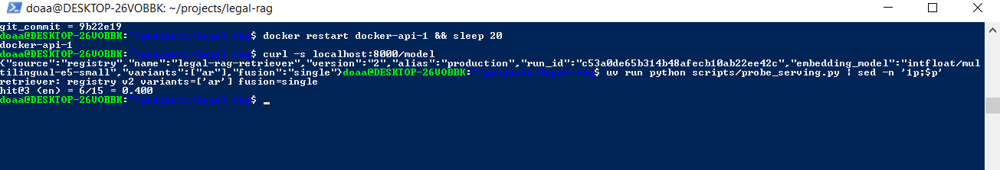
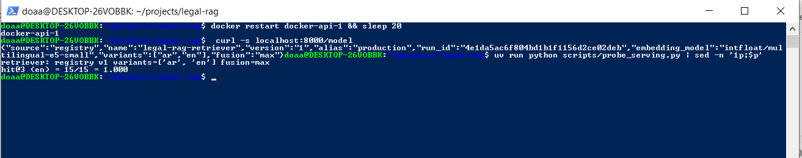

Version 2 is exactly the retriever the API served before this step, so the 6 / 15 is what Module 1's service would have scored on English questions. Both numbers are on the dev questions the config was chosen on; the hold-out (about 0.6) is the estimate for new questions.

### `promote_if_better`

`registry.py` compares a candidate version with the version behind an alias on a metric and moves the alias only if the candidate wins. A tie never wins, a margin can be set, and `--lower-is-better` covers error metrics (the handbook's example is MAE; here hit@3, MRR and faithfulness are higher-is-better). Only "the alias does not exist" counts as "nothing to beat": any other registry error stops the gate, because an outage must not promote a candidate. Used to put version 1 back:

```
$ python -m legal_rag.registry challenge --run-id 4e1da5ac...
PROMOTED to production: better by 0.3000 (margin 0.0) (candidate 1.0, incumbent 0.7)
```

Continuous training (Step 7) will call it with `--target staging`: the pipeline may fill Staging, a person moves Production.

## Step 4 — DVC

`dvc.yaml` has two stages, and the source PDF is tracked by `data/raw/laws.pdf.dvc`:

| Path | Tracked by | Rebuilt by |
|---|---|---|
| `data/raw/laws.pdf` | `data/raw/laws.pdf.dvc` | downloaded (copyrighted: never in git) |
| `data/processed/civil_code.json` | stage `parse` | `legal_rag.parse_civil_code`, 1149 articles |
| `models/e5-small-onnx/` (4 files, 487 MB) | stage `export` | `legal_rag.export` |

`dvc repro` rebuilt the corpus from the PDF with the same SHA-256 as before DVC (first 12 characters `128100437220`, the `data_version` of every earlier run), so the parser is deterministic. A second `dvc repro` skips all stages, `git diff dvc.lock` is empty and `dvc status` is clean. The corpus JSON left git (`git rm --cached`): it is a build product now, which is why the tests and CI start with a `dvc pull`.

**Two remotes.** `storage` is a bucket on the RustFS already running in the tracking stack (the handbook's S3-compatible MinIO path). `gdrive` is a Google Drive folder, because the CI runners on GitHub cannot reach `localhost`. Proof that the remote is the source of truth: the local cache was deleted (`rm -rf .dvc/cache`) together with the PDF, the JSON and the encoder, and `dvc pull` brought back all 7 files from each remote, twice for `storage`.

**Lineage.** `lineage.py` reads `dvc.lock` and `experiments.py` / `finalists.py` add three tags to every new run: `dvc_source_pdf_md5`, `dvc_corpus_md5` and `dvc_in_sync` (false when the corpus on disk is not the one the lock describes). `data_version` stays as it was, so older runs remain comparable. The chain is: model version → MLflow run → `git_commit` → DVC hashes → `dvc pull` of that data.

## Step 5 — Continuous integration

`.github/workflows/ci.yml` runs on every pull request and on pushes to `main`: **lint → test → build**.

| Job | What it does |
|---|---|
| lint | `ruff check` and `ruff format --check`, same ruff version as pre-commit |
| test | pulls the corpus from DVC, runs `pytest` with the 70 % coverage gate |
| build | pulls the corpus and the encoder, rebuilds the Chroma index, runs the faithfulness gate, then builds the image and pushes it to Docker Hub as `sha-<commit>` (and `latest` on `main`) |

**Quality gate.** `python -m legal_rag.faithfulness --lang ar --threshold 0.75` fails the job when mean faithfulness drops below 0.75; the image is pushed only after it passes. Run in CI it scored 0.983 (PASS) on the 15 Arabic dev questions, all 15 answers and 15 judge scores read from the committed cache, so the run spent 0 judge tokens (51,500 without the cache). The handbook asks for 20 questions; the cached evaluation set is these 15, which is a known limit.

**Red, then green.** A pull request that raised the gate to 0.99 turned the build red: mean faithfulness is 0.983, below 0.99, so the gate exits 1, `lint` and `test` stay green and the image is not built. The real pull request is green, and so is its latest run after the Terraform and continuous-training commits.

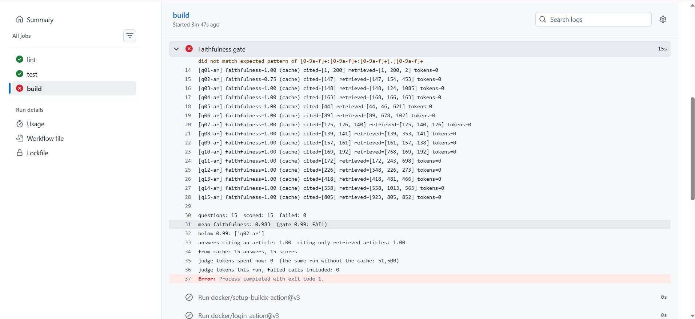
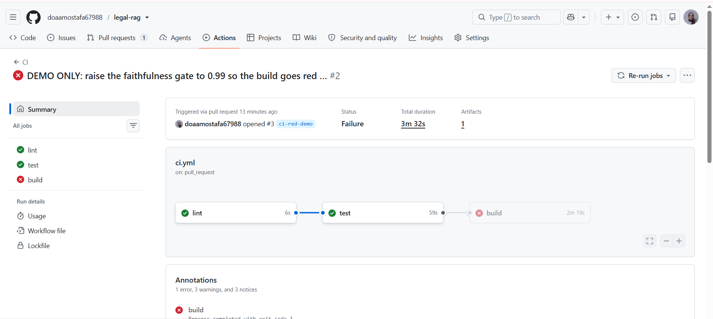
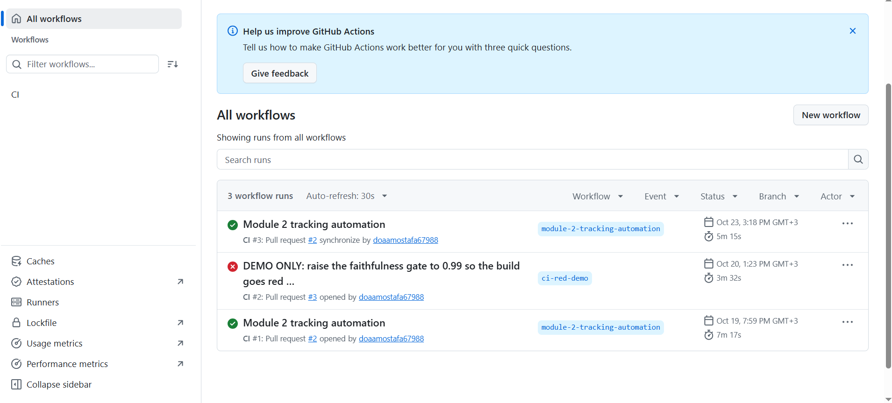


**Branch protection on `main`.** A pull request is required, and so are the three status checks `lint`, `test` and `build`, with the branch up to date, so a red check cannot be merged.

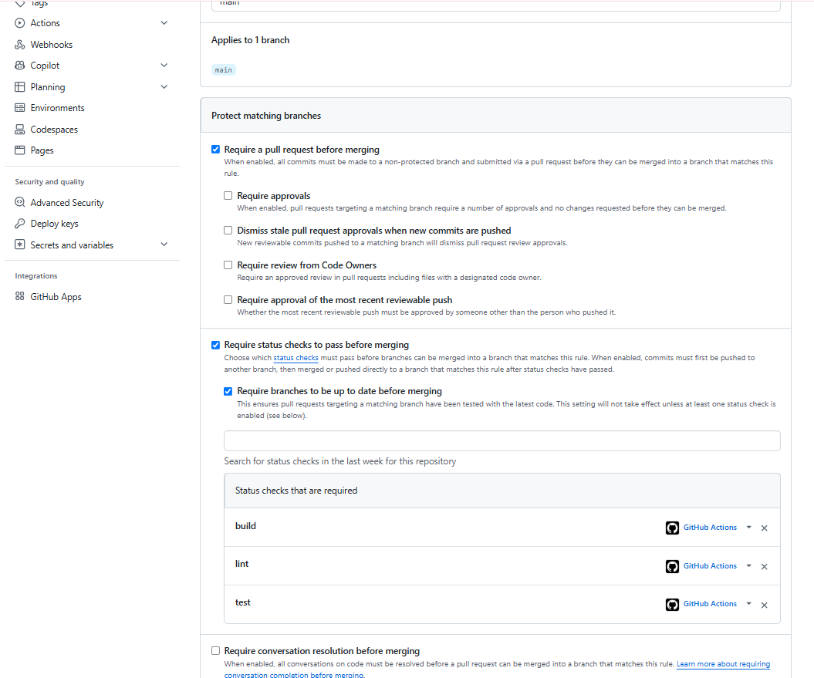

**Design choices.**
- Hosted GitHub runners, because the repository is public: a self-hosted runner would execute code from other people's pull requests on this machine. The price is that CI cannot reach the MLflow server on `localhost`, so the registry-based `promote_if_better` gate is not in CI. The gate that runs there is the faithfulness one.
- Secrets (Docker Hub, the Drive service account, Groq) are repository secrets. Pull requests from forks build but do not push, since secrets are not passed to them.

## Step 6 — Terraform

The no-cloud infrastructure path uses the Terraform Docker provider to manage PostgreSQL, RustFS, and MLflow locally. The infrastructure was initialized, formatted, validated, planned, applied, destroyed, and applied again successfully. The smoke test passed: MLflow answered its health check and successfully wrote to its database.

The provider version is pinned in `infra/.terraform.lock.hcl`. Terraform state and local plan files are excluded from Git because state can contain secrets and local execution details.

### Why Terraform State Should Not Be Committed

Terraform’s state file records every attribute of every resource in clear text, including values marked sensitive (here the database password and the object-store keys), so committing it publishes secrets. It is also machine-written and changes on every apply, so it causes merge conflicts, and two people applying from different copies overwrite each other’s view of the infrastructure. A remote backend (an object-store bucket, GCS, Terraform Cloud) keeps one shared, encrypted, versioned copy outside git and locks it while someone applies, which a local file cannot do.

## Step 7 — Continuous training

`.github/workflows/continuous-training.yml` implements trigger → dvc pull → validate data → train → evaluate → gate → promote to Staging → build image → notify. It runs on the self-hosted runner (label `legal-rag`) because it needs the MLflow server and the registry on this machine. It never runs for pull requests, so a self-hosted runner is safe on a public repository.

**Three triggers.** A weekly cron (Monday 03:00 UTC); `workflow_dispatch` with the inputs `data_ref` (a git ref whose `dvc.lock` defines the data to use), `metric` and `margin`; and `repository_dispatch` (`data-drift-detected`, `retrain`), the hook a drift detector fires into. The inputs are validated before they reach any shell command.

**Pipeline.**
1. `dvc pull` fetches the corpus and the encoder, optionally at the data version given by `data_ref`.
2. `legal_rag.validate_data` rejects a corpus with too few articles, repeated article numbers, or active articles without text.
3. The candidate is the configuration in production (e5-small, Arabic and English vectors, `max`) trained on that data into the `legal-rag-ct` experiment, then registered as a new model version.
4. `legal_rag.ct gate` compares it with the version behind `production` on `mrr` (hit@3 is saturated at 1.0 on the dev set) and gives it the `staging` alias only if it wins by more than a configurable margin. A candidate that loses is logged and the job exits 0: a lost challenge is not a build failure, and no image is built.
5. A winner gets an image tagged `staging-<commit>` on Docker Hub, and the job summary (and an optional Slack message) reports the outcome.

**Production is never automatic.** The last job runs in the GitHub Environment `production`, which requires a reviewer's approval before it moves the `production` alias. Staging is automatic because it costs nothing and nothing serves from it. Production needs a person because the gate checks one metric on a small dev set, so someone has to read the evidence (misses, faithfulness) before the alias moves, and a wrong legal answer served to users is worth a click.

| Trigger | Implemented now | Module 5 adds |
|---|---|---|
| Schedule | Weekly cron, Monday 03:00 UTC | — |
| Data drift | The `repository_dispatch` hook runs the whole pipeline | The drift detector that fires it |
| Performance degradation | Not automatic; a person can start the workflow when live quality drops | Monitoring of live signals (low retrieval scores, feedback) that fires the same hook |
| New labeled data | Manual: `workflow_dispatch` with a `data_ref` pointing at the new data | Automatic start when a new `dvc.lock` is merged |

**Runs.** `workflow_dispatch` only works for a workflow file on the default branch, so both runs were started by hand from `main`, on the self-hosted runner.

1. **`margin = 0.01`: a lost challenge.** The candidate (model version 3) is the production configuration trained again on the same data, so its `mrr` ties with production (0.8167 against 0.8167). The gain is 0.0000 and does not exceed the margin, so the gate does not promote it, nothing is built, `promote-production` is skipped, and the run stays green: a lost challenge is not a build failure.

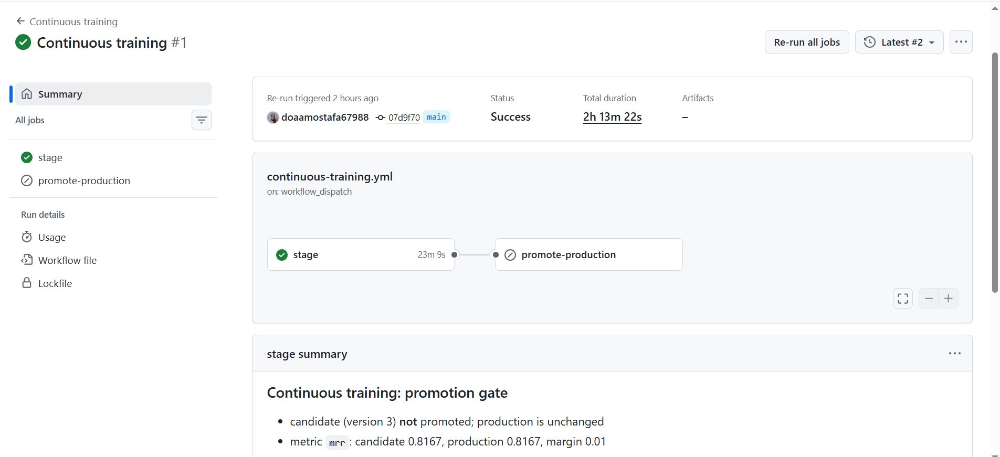

2. **`margin = -0.01`: the whole path.** A tie never wins, and a negative margin lets it through, which is how the full path is exercised. The candidate (version 4) took the `staging` alias, the image `staging-<commit>` was pushed to Docker Hub, and `promote-production` waited for approval of the `production` environment before it moved the `production` alias. `stage` took 29 minutes on this machine; the approval step took 12 seconds.

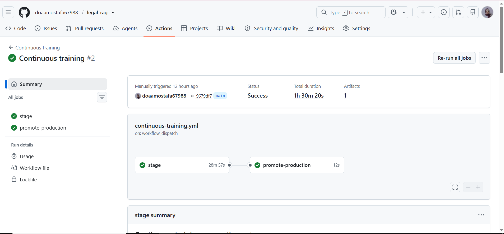

Registry after the two runs. Version 4 has the same configuration as version 1, so the answers the service gives do not change; the aliases moved to the newest version:

```
legal-rag-retriever
  v1  [None]  run 4e1da5ac
  v2  [None]  run c53a0de6
  v3  [None]  run 35837985
  v4  [production, staging]  run 072979d7
```

Versions that lose a challenge stay in the registry without an alias (version 3), and the weekly schedule would add one each Monday, so the workflow is disabled between demonstrations.

## Hold-out and data notes

Dev numbers are a tuning signal; the hold-out numbers above are the estimate for new questions. Every figure in the Step 3 table is on the dev questions.

## Problems met

- **Artifact download hung** (`misses.json` could not be downloaded, retries every 90 s). The MLflow server answered 200 on every request, but the presigned download URL it returns points at `http://s3:9000/...`, the container name inside the Compose network. The host (WSL) cannot resolve `s3`. Uploading worked because it goes through the server. Fix: `127.0.0.1 s3` in `/etc/hosts` (port 9000 is published on localhost, and the signature stays valid because the `Host` header stays `s3:9000`). WSL regenerates `/etc/hosts` on restart; `generateHosts = false` in `/etc/wsl.conf` keeps it.
- **Unpinned image:** `rustfs/rustfs:latest` in the tracking compose file; to be pinned to a digest.
- **The API could not reach MLflow (403 "Invalid Host header").** MLflow 3.17 validates the `Host` header against an allow-list (protection against DNS rebinding), and the API calls it as `mlflow:5000`, the Compose service name. Fix: `MLFLOW_SERVER_ALLOWED_HOSTS: "localhost:*,127.0.0.1:*,mlflow:*"` on the server, not `*`.
- **Startup crash from a log call.** The registry loader logged the model info with `extra={"name": ...}`, and `name` is a reserved `LogRecord` attribute (`KeyError: Attempt to overwrite 'name'`). Fix: the extra keys are prefixed (`model_name`, ...), with a regression test that fails on the old call.
- **My own probe counted 0 / 15.** `probe_serving.py` looked for `Art. 147` but the API cites `Article 147`, so every hit was marked a miss. Fixed the pattern; the first run of both versions looked identical for that reason.
- **DVC lost the encoder folder.** `dvc add models/e5-small-onnx` wrote a `.dvc` file with the right hash (4 files, 487 MB), but `dvc data status` never listed the folder and a later `dvc pull` deleted it from the workspace. The objects were still in the cache, so the folder was restored from there. Fix: declare it as the output of a stage (`dvc stage add -n export ...`, then `dvc commit`, which records it without re-running the export). Lesson: `dvc status` saying "up to date" is not proof; delete the folder and `dvc pull` it back.
- **Google Drive: service accounts cannot upload.** The push failed with "Service Accounts do not have storage quota". Fix: upload with the owner's own OAuth credentials (a local setting, never committed) and let CI *read* with the service account, which needs no quota. Large transfers also hit `Broken pipe` / `SSL: UNEXPECTED_EOF`; retrying with a single job (`-j 1`) completed them.
- **Docker did not start after a WSL restart** (Docker Engine runs inside WSL, not Docker Desktop). Fix: `systemctl enable --now docker`, with `systemd=true` in `/etc/wsl.conf`.
- **The self-hosted runner lost contact in the middle of a run.** WSL had 3.8 GB of RAM and a full swap. Two MLflow servers were running at once (the Compose stack and the Terraform demonstration stack, whose containers restart by themselves), and each ran a dozen background job workers (`huey_consumer`): one server alone used 2.19 GB. With torch embedding the corpus on top, the runner was starved. Fixes: more WSL memory (`.wslconfig`: 5 GB RAM, 8 GB swap), `terraform destroy` of the demonstration stack once its evidence was saved, `MLFLOW_SERVER_ENABLE_JOB_EXECUTION=false` on the MLflow server (2.19 GB down to 0.88 GB, 16 processes down to 8), the embedding cache kept outside the checkout that is cleaned on every run, and a pre-flight step in the workflow that fails in seconds when less than 1500 MB are free or MLflow does not answer.
- **Docker lost a layer and a container snapshot.** After WSL had been closed in the middle of operations, `docker compose up` failed with `failed to extract layer ... content digest not found` and `docker system df` with `rw layer snapshot not found for container`. The likely cause is WSL stopping while Docker was writing; this was not investigated further. Restarting WSL (`wsl --shutdown`) brought the daemon back and the tracking stack started again. The data volumes were never touched: nothing was run with `-v`.
